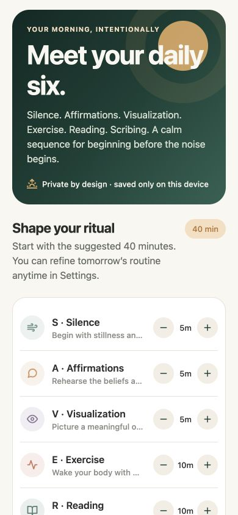
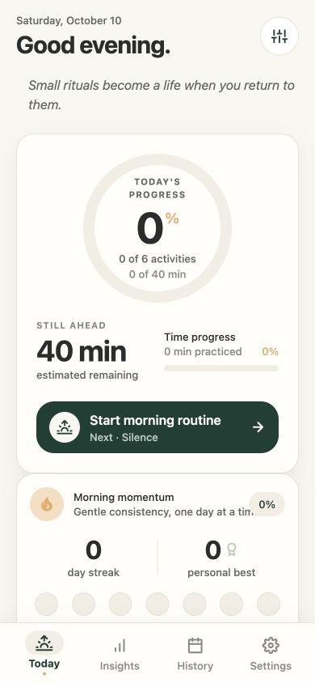
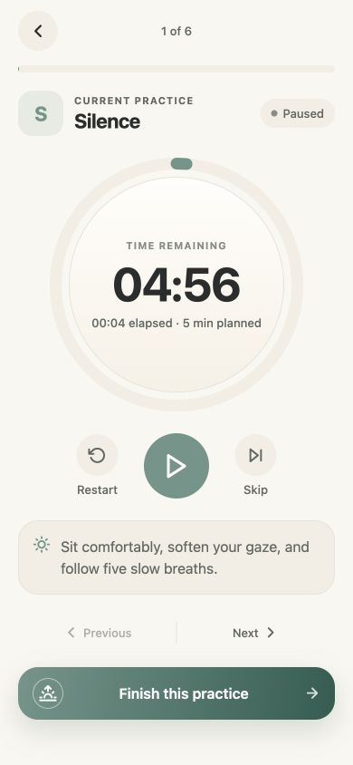
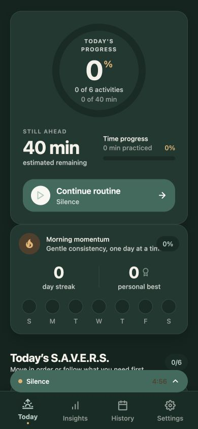
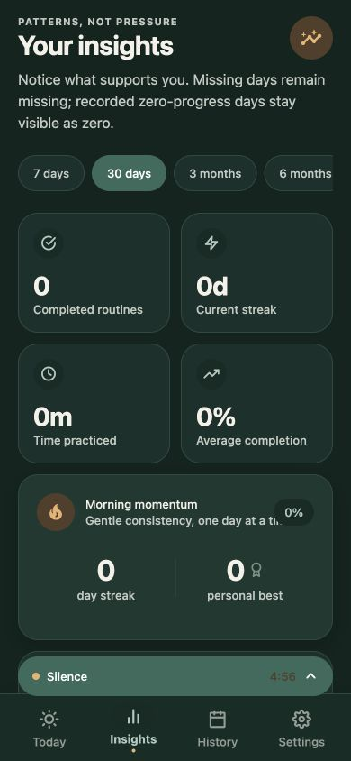
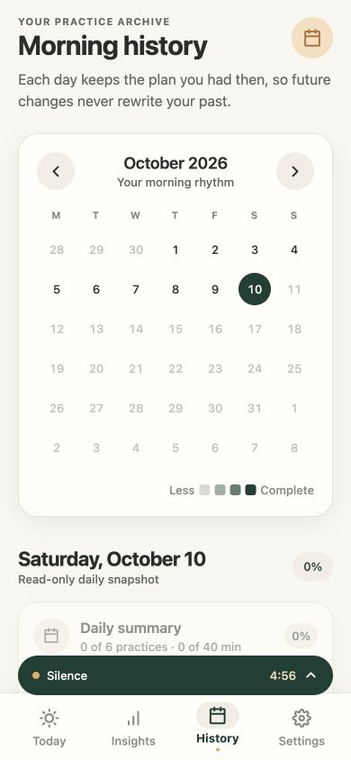

<p align="center">
  
</p>

# FirstLight S.A.V.E.R.S. — Morning Routine & Habit Tracker

[](https://github.com/masudfcs1/masudfcs1-firstlight-savers-Morning-Routine-Habit-Tracker/actions/workflows/mobile-ci.yml)

Begin with intention. FirstLight brings Silence, Affirmations, Visualization, Exercise, Reading, and Scribing into one calm morning routine for Android and iPhone.

Inspired by Hal Elrod's S.A.V.E.R.S. framework, FirstLight combines resumable timers, daily progress, local history, streaks, insights, and a warm light/dark visual system. Your routine stays on your device; no account or backend is required.

## App preview

Actual app screens captured from the Expo web build at a phone-sized viewport. These show a new local routine, without generated history or demonstration analytics.

<table>
  <tr>
    <th>Shape your ritual</th>
    <th>Today · light</th>
    <th>Focused timer</th>
  </tr>
  <tr>
    <td></td>
    <td></td>
    <td></td>
  </tr>
  <tr>
    <th>Today · dark</th>
    <th>Your insights</th>
    <th>Morning history</th>
  </tr>
  <tr>
    <td></td>
    <td></td>
    <td></td>
  </tr>
</table>

## Features

- Six customizable practices with duration, order, guidance, and enable/disable controls.
- Timestamp-based timers that recover after backgrounding or restarting the app.
- Explicit completion confirmation, with elapsed, credited, manual, and skipped time kept distinct.
- Daily progress rings, immutable historical plans, calendar details, and activity timelines.
- Daily, weekly, and monthly charts, activity breakdowns, heatmaps, streaks, and milestones.
- Optional reminders, haptics, reduced motion, and light/dark/system appearance.
- Versioned local storage with validated JSON export/import.

## GitHub Actions: Android and iPhone

Every push or pull request to `main` runs the quality checks and builds native preview artifacts. Download them from [Actions → Android & iOS → a completed run → Artifacts](https://github.com/masudfcs1/masudfcs1-firstlight-savers-Morning-Routine-Habit-Tracker/actions/workflows/mobile-ci.yml).

| Build | Download | Requirements |
| --- | --- | --- |
| Android | Standalone APK with bundled JavaScript | Android ARM64 device or x86_64 emulator; preview/debug signing key |
| iPhone Simulator | Unsigned ARM64 `.app` ZIP | iPhone Simulator on an Apple Silicon Mac |
| Web | Static web build | Any static HTTP server |

The automatic iOS artifact runs in Simulator. For installation on a physical iPhone, the [manual EAS device workflow](https://github.com/masudfcs1/masudfcs1-firstlight-savers-Morning-Routine-Habit-Tracker/actions/workflows/eas-device-build.yml) is included; link an Expo project, add the `EXPO_TOKEN` Actions secret, and configure Apple signing first. No store submission runs automatically. See [Android and iPhone build instructions](.github/BUILDING.md) for setup and artifact details.

## Stack

- Expo SDK 57, React Native, and strict TypeScript
- NativeWind for utility styling and shared theme tokens
- React Navigation for the native stack and bottom tabs
- Reanimated, Gesture Handler, SVG, Linear Gradient, and Haptics for motion and feedback
- Zustand for app state
- AsyncStorage for versioned, Expo Go-compatible local persistence
- Jest for domain tests

## Run locally

Requirements: Node.js 22.13 or newer, npm, and either Expo Go or a native simulator/toolchain.

```bash
npm install
npm run start
```

From the Expo terminal, scan the QR code with Expo Go or press `a` for Android and `i` for iOS. If Metro has stale state, run `npm run start:clear`.

Direct scripts:

```bash
npm run android
npm run ios
npm run web
```

## Quality checks

```bash
npm run typecheck
npm run lint
npm test
npx expo-doctor
```

## Device previews and store builds

Expo Go supports the dependencies used by this project. For standalone previews or store builds, sign in to EAS and link the project once. The included `eas.json` provides preview, simulator, and production profiles:

```bash
npx eas-cli@24.12.1 login
npx eas-cli@24.12.1 init
npx eas-cli@24.12.1 build --profile preview --platform android
npx eas-cli@24.12.1 build --profile preview --platform ios
npx eas-cli@24.12.1 build --profile simulator --platform ios
npx eas-cli@24.12.1 build --profile production --platform all
```

An Apple Developer account is required for signed iOS device/store builds and a Google Play developer account is required for Play Store distribution.

## Data and persistence

The app has no account, backend, telemetry, or cloud dependency. One versioned JSON document is stored in AsyncStorage on the device. It contains:

- the user's routine configuration and preferences;
- one immutable activity-plan snapshot per opened routine day;
- authoritative activity status, elapsed/completed seconds, completion method, and timestamps;
- a resumable active timer session.

Totals, percentages, streaks, milestones, and charts are derived from the authoritative activity records rather than persisted as independent counters. Storage migrations run before hydration. Import validates and migrates a backup before replacing the live document; export writes the same portable JSON envelope.

AsyncStorage was selected instead of MMKV so the managed project remains compatible with Expo Go. Device backups are subject to the operating system's app-data behavior; use the in-app export action for a portable copy.

## Date and timer behavior

- Day keys use the device's local calendar in `YYYY-MM-DD` form. A historical key is never rewritten after a timezone change.
- A routine is pinned to the date on which it was initialized. If its timer crosses midnight, completion remains attached to that original routine day.
- Changing, disabling, or reordering activities affects only days initialized afterward; historical daily snapshots remain unchanged.
- A completed day means every enabled activity in that day's snapshot is completed. Skipped activities do not count as completed.
- Running timers store an anchor timestamp plus accumulated elapsed seconds. The UI derives remaining time from `Date.now()`, so backgrounding, locking, closing, or relaunching does not depend on interval callbacks.
- Reaching zero never silently completes an activity. The app asks for confirmation, records actual elapsed time, and guards completion updates idempotently.

## Metric definitions

- **Activity progress:** completed enabled activities ÷ enabled activities in that day.
- **Time progress:** credited completed seconds ÷ planned seconds, clamped to 0–100%.
- **Current streak:** consecutive fully completed recorded days ending today, or yesterday when today is not yet complete.
- **Longest streak:** longest run of fully completed routine days.
- **Weekly/monthly rate:** fully completed recorded routine days ÷ calendar days in the visible window up to today.
- **Average completion:** mean daily activity completion for recorded days in the selected range.
- **No record vs. zero:** charts render absent days separately from a routine that exists with 0% progress.

## Project layout

```text
src/
  app/          navigation and providers
  components/   reusable UI, motion, charts, calendar
  features/     onboarding, today, timer, insights, history, settings
  hooks/        local-date lifecycle hooks
  services/     progress, timer, streak, analytics, notifications
  storage/      AsyncStorage repository, validation, migrations
  store/        Zustand orchestration and persistence actions
  theme/        tokens and theme context
  types/        strict domain and navigation types
  utils/        local date and formatting helpers
```

## Reminder limitations

Reminders are optional local notifications. The app requests permission only when the user enables them. Delivery is ultimately controlled by the operating system's permission, focus, battery, and scheduling policies. Timer accuracy does not depend on notification delivery.
